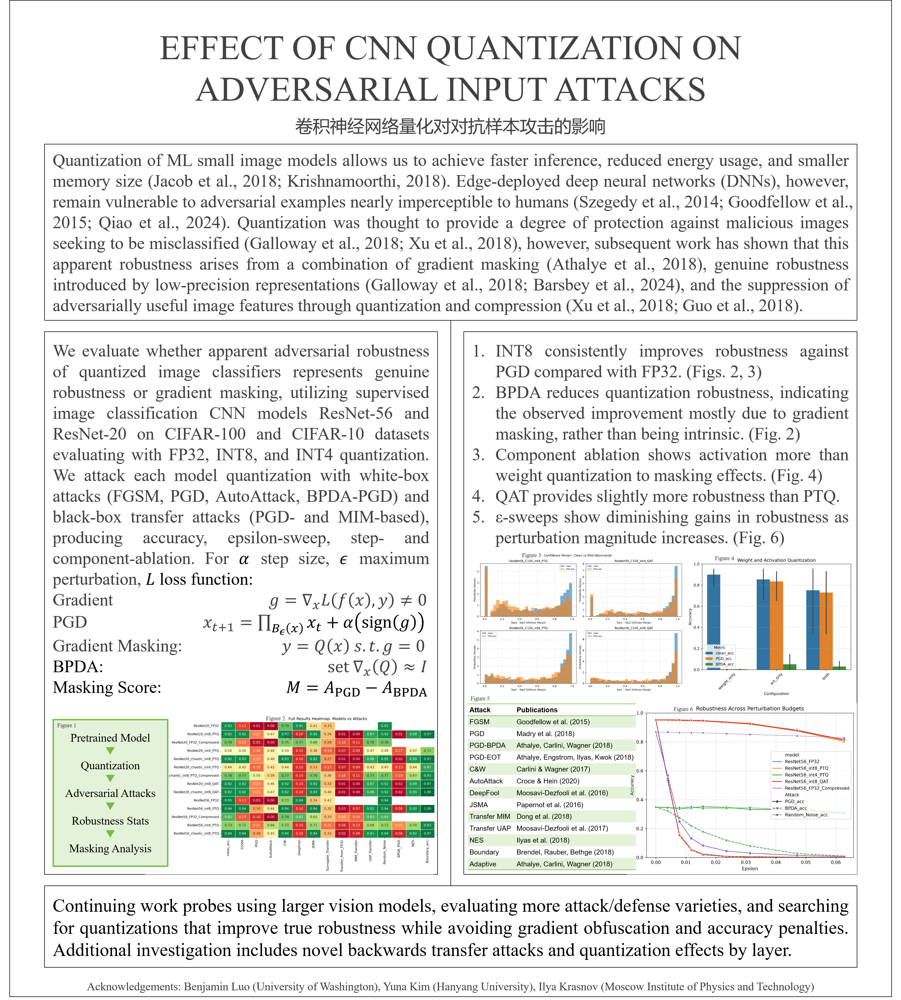
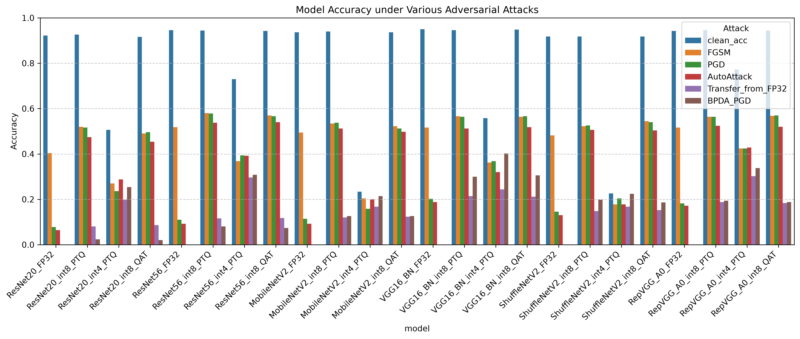
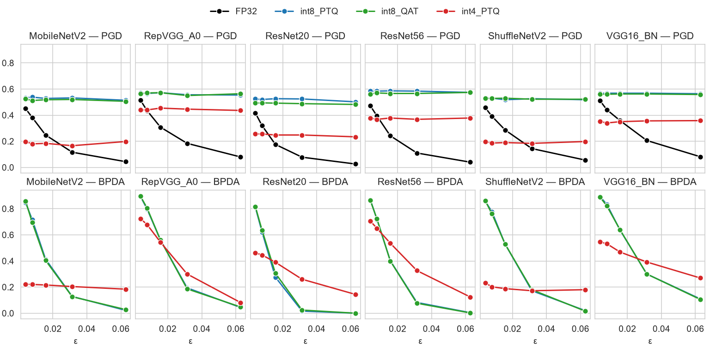
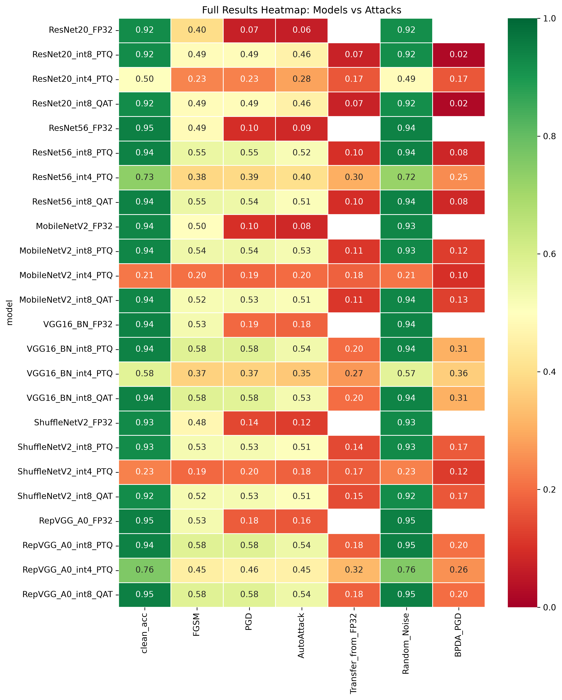

# QuantAdv
Quantized models introduce discrete rounding operations into the computational graph, which may produce either genuine robustness against *inference-time evasion attacks* (coarser weight representation changing the decision boundary geometry) or gradient masking (rounding causing zero gradients that blind attacks). The current configuration evaluates pretrained TorchCV ResNet56, WRN-28-10, and DenseNet-100 models on CIFAR-100 across FP32, INT8, INT4 (PTQ/QAT - without/with fine tuning) variants using a layered attack suite. 
Quantization is acheived using a *fake quantization* approach through computing $w_q = \mathrm{clamp}(\mathrm{round}(w/s) + z,\, q_{\min},\, q_{\max})$, then dequantizing $\hat w = s\,(w_q - z)$ and calling standard `F.conv2d`.
Dataset construction, preprocessing, class count, and TorchCV model identifiers are selected centrally in `src/config.py`.

## Setup

To install dependencies  
`pip install -r requirements.txt`

To download datasets (should be placed at root)  
*CIFAR-10*
```
wget https://www.cs.toronto.edu/~kriz/cifar-10-python.tar.gz
curl -O https://www.cs.toronto.edu/~kriz/cifar-10-python.tar.gz
```

*CIFAR-100*
```
wget https://www.cs.toronto.edu/~kriz/cifar-100-python.tar.gz
curl -O https://www.cs.toronto.edu/~kriz/cifar-100-python.tar.gz
```

or set `DATASET_DOWNLOAD=true` in `./src/config.py`

To run (and automatically generate visualizations)  
`python -m src.QuantAdv`  

To graph from incomplete results  
`python -m src.graphs.combine`

To generate condensed figures for publication  
`python -m src.graphs.formaldata`

[//]: # (> **Notice:** You may need to adjust pathing or move the scripts to root for obsolete files.)

Results are in `./data`






## More Notes on Fake-Quantization

We take each pretrained model’s convolution and linear
layers, round their weights and weights' outputs to an INT8 or INT4 grid, then convert those rounded values
back to FP32. In PTQ, we do this without adjusting the pretrained weights. In QAT, we fine-
tune weights while the rounding is active so the model can
adapt. This simulates relatively realistically how low-precision rounding affects accuracy and
adversarial attacks, but crucially it does not run the network using integer
arithmetic or measure the speed/memory gains of a deployed
integer model.

$$
s_{\mathrm{weight}} =
\max\left(
\frac{2\max(|x_{\mathrm{min}}|,|x_{\mathrm{max}}|)}
{q_{\mathrm{max}}-q_{\mathrm{min}}},
\mathrm{QUANT\_SCALE\_MIN}
\right),
\qquad z=0
$$

### Even More Notes
[`attack_notes.md`](attack_notes.md)
[`general_notes.md`](general_notes.md)

## Readings

- [Compression Aware Certified Training](https://arxiv.org/abs/2506.11992) — Changming Xu and Gagandeep Singh (2025).
- [On the Interaction of Compressibility and Adversarial Robustness](https://arxiv.org/abs/2507.17725) — Melih Barsbey, Antônio H. Ribeiro, Umut Şimşekli, and Tolga Birdal (2025).
- [Defensive Quantization: When Efficiency Meets Robustness](https://research.ibm.com/publications/defensive-quantization-when-efficiency-meets-robustness) — Ji Lin, Chuang Gan, and Song Han (ICLR, 2019).
- [Quantization Aware Attack: Enhancing Transferable Adversarial Attacks by Model Quantization](https://arxiv.org/abs/2305.05875) — Yulong Yang et al. (2023).
- [RobustMQ: Benchmarking Robustness of Quantized Models](https://doi.org/10.1007/s44267-023-00031-w) — Yisong Xiao, Aishan Liu, Tianyuan Zhang, Haotong Qin, Jinyang Guo, and Xianglong Liu (2023).
- [Investigating the Impact of Quantization on Adversarial Robustness](https://arxiv.org/abs/2404.05639) — Qun Li, Yuan Meng, Chen Tang, Jiacheng Jiang, and Zhi Wang (2024).
- [Chaotic Neural Network Quantization and Its Robustness Against Adversarial Attacks](https://doi.org/10.1016/j.knosys.2023.111319) — Alaa Osama, Samar I. Gadallah, Lobna A. Said, Ahmed G. Radwan, and Mohammed E. Fouda (2024).
- [Explaining and Harnessing Adversarial Examples](https://research.google/pubs/explaining-and-harnessing-adversarial-examples/) — Ian J. Goodfellow, Jonathon Shlens, and Christian Szegedy (ICLR, 2015).
- [Synthesizing Robust Adversarial Examples](https://proceedings.mlr.press/v80/athalye18b.html) — Anish Athalye, Logan Engstrom, Andrew Ilyas, and Kevin Kwok (ICML, 2018).
- [Obfuscated Gradients Give a False Sense of Security: Circumventing Defenses to Adversarial Examples](https://proceedings.mlr.press/v80/athalye18a.html) — Anish Athalye, Nicholas Carlini, and David Wagner (ICML, 2018).
- [On Evaluating Adversarial Robustness](https://arxiv.org/abs/1902.06705) — Nicholas Carlini et al. (2019).
- [Reliable Evaluation of Adversarial Robustness with an Ensemble of Diverse Parameter-Free Attacks](https://proceedings.mlr.press/v119/croce20b.html) — Francesco Croce and Matthias Hein (ICML, 2020).
- [Boosting Adversarial Attacks with Momentum](https://doi.org/10.1109/CVPR.2018.00957) — Yinpeng Dong, Fangzhou Liao, Tianyu Pang, Hang Su, Jun Zhu, Xiaolin Hu, and Jianguo Li (CVPR, 2018).
- [Universal Adversarial Perturbations](https://doi.org/10.1109/CVPR.2017.17) — Seyed-Mohsen Moosavi-Dezfooli, Alhussein Fawzi, Omar Fawzi, and Pascal Frossard (CVPR, 2017).
- [Decision-Based Adversarial Attacks: Reliable Attacks Against Black-Box Machine Learning](https://arxiv.org/abs/1712.04248) — Wieland Brendel, Jonas Rauber, and Matthias Bethge (ICLR, 2018).
- [Practical Black-Box Attacks against Machine Learning](https://doi.org/10.1145/3052973.3053009) — Nicolas Papernot, Patrick McDaniel, Ian Goodfellow, Somesh Jha, Z. Berkay Celik, and Ananthram Swami (ACM AsiaCCS, 2017).
- [Towards Deep Learning Models Resistant to Adversarial Attacks](https://arxiv.org/abs/1706.06083) — Aleksander Madry, Aleksandar Makelov, Ludwig Schmidt, Dimitris Tsipras, and Adrian Vladu (ICLR, 2018).
- [Fast Is Better Than Free: Revisiting Adversarial Training](https://arxiv.org/abs/2001.03994) — Eric Wong, Leslie Rice, and J. Zico Kolter (ICLR, 2020).
- [Adversarial Examples Are Not Bugs, They Are Features](https://doi.org/10.48550/arXiv.1905.02175) — Andrew Ilyas, Shibani Santurkar, Dimitris Tsipras, Logan Engstrom, Brandon Tran, and Aleksander Madry (NeurIPS, 2019).
- [Improving Adversarial Robustness Requires Revisiting Misclassified Examples](https://arxiv.org/search/?query=Improving+Adversarial+Robustness+Requires+Revisiting+Misclassified+Examples&searchtype=title) — Wang et al. (publication details to verify).
- [How Does Batch Normalization Help Optimization?](https://arxiv.org/abs/1805.11604) — Shibani Santurkar, Dimitris Tsipras, Andrew Ilyas, and Aleksander Madry (NeurIPS, 2018).
- [Certified Adversarial Robustness via Randomized Smoothing](https://proceedings.mlr.press/v97/cohen19c.html) — Jeremy Cohen, Elan Rosenfeld, and J. Zico Kolter (ICML, 2019).
- [Provably Robust Deep Learning via Adversarially Trained Smoothed Classifiers](https://arxiv.org/abs/1906.04584) — Hadi Salman, Greg Yang, Jerry Li, Pengchuan Zhang, Huan Zhang, Ilya Razenshteyn, and Sébastien Bubeck (NeurIPS, 2019).
- [Provable Defenses against Adversarial Examples via the Convex Outer Adversarial Polytope](https://proceedings.mlr.press/v80/wong18a.html) — Eric Wong and J. Zico Kolter (ICML, 2018).
- [Scaling Provable Adversarial Defenses](https://arxiv.org/abs/1805.12514) — Eric Wong, Frank R. Schmidt, Jan Hendrik Metzen, and J. Zico Kolter (NeurIPS, 2018).
- [Adversarial Pruning: A Survey and Benchmark of Pruning Methods for Adversarial Robustness](https://doi.org/10.1016/j.patcog.2025.111788) — Giorgio Piras, Maura Pintor, Ambra Demontis, Battista Biggio, Giorgio Giacinto, and Fabio Roli (Pattern Recognition, 2025).
- [Towards Quantum Enhanced Adversarial Robustness in Machine Learning](https://doi.org/10.1038/s42256-023-00661-1) — Maxwell T. West, Shu-Lok Tsang, Jia S. Low, Charles D. Hill, Christopher Leckie, Lloyd C. L. Hollenberg, Sarah M. Erfani, and Muhammad Usman (Nature Machine Intelligence, 2023).
- [Adversarial Machine Learning: A Taxonomy and Terminology of Attacks and Mitigations](https://doi.org/10.6028/NIST.AI.100-2e2023) — Apostol Vassilev, Alina Oprea, Alie Fordyce, and Hyrum Anderson (NIST, 2024).
- [A Survey on Adversarial Machine Learning: Attacks, Defenses, Real-World Applications, and Future Research Directions](https://doi.org/10.1016/j.neucom.2026.132670) — Yan Qiao, Nimitha Bangalore Sathyanarayana, and Chaowei Shi (Neurocomputing, 2026).
